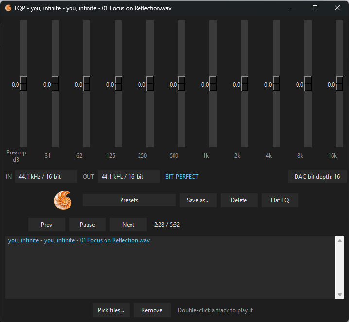
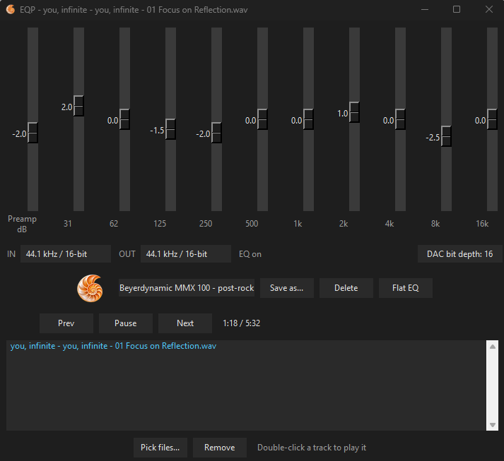

<p align="center">
  
</p>

# EQP — EQ Player

**Explicit verification and control of the audio data going from a Windows
machine into your DAC, at exactly the sample rate and bit depth your DAC
expects.**

EQP is a small, single-file audio player for Windows. It bypasses the Windows
mixer, sends audio straight to your DAC, and tells you in plain terms what it
is doing to the signal on the way: nothing at all, or exactly what.

It also has a 10-band graphic EQ with named presets, for when you want to
change the sound on purpose.

| EQ flat: the DAC gets the file's samples unchanged | EQ in use: the readout says so |
|---|---|
|  |  |

## Why this exists

Ordinary Windows playback goes through the system mixer. The mixer converts
everything to whatever format is set in the Sound control panel, may resample
it, and can apply "enhancements", all without telling you. If you have paid
for a DAC, an amplifier and good headphones, you cannot easily tell whether
the DAC is receiving the music as it is stored in the file.

EQP answers that question directly:

- It opens the DAC in **WASAPI exclusive mode**, so the Windows mixer is not
  in the path at all.
- It shows an **IN** format (what the file contains) and an **OUT** format
  (what is being sent to the DAC).
- When the two match and nothing is being altered, it says **BIT-PERFECT**:
  the DAC is receiving the file's samples, unchanged.
- When something is being altered, it says what: `resampled`,
  `bit depth reduced`, `EQ on`, `lossy source`.

## Features

- **Exclusive-mode output** to any Windows audio device.
- **IN / OUT readout** with a bit-perfect indicator.
- **Automatic sample-rate matching.** EQP tries the file's own rate first. If
  the DAC refuses it, EQP steps down to the nearest rate the DAC accepts and
  converts the track, and the readout says so.
- **Per-DAC bit depth** (16, 24 or 32), remembered by device name.
- **10-band graphic EQ** (31 Hz to 16 kHz, ±12 dB) with a preamp slider, a
  clipping warning, and properly dithered output.
- **Named EQ presets** you can save, load and delete. Your last settings are
  restored on the next launch.
- **Playlist** with a file picker, auto-advance, and previous/next.
- **Dropout counter**, so you can tell a struggling PC from a faulty DAC.
- **Dark theme.** No installer; one Python file plus an icon folder.
- **`flaccheck.py`**, a companion script that reports a file's real format and
  looks for signs that a "lossless" file was made from a lossy one.

## You need to know your DAC

This is the part EQP cannot do for you, so please read it.

**Sample rate is verified. Bit depth is not.**

- **Sample rate:** in exclusive mode the DAC's driver refuses rates it does
  not support, so the OUT sample rate EQP shows is one the DAC has actually
  accepted.
- **Bit depth:** the audio library EQP uses will quietly convert if you ask
  for more bits than the DAC has, instead of refusing. EQP therefore cannot
  detect your DAC's true bit depth. The **DAC bit depth** setting is something
  you tell EQP, and the OUT bit depth shows what EQP sends, not a reading
  taken from the DAC.

So you need your DAC's specification: its **maximum bit depth** and its
**supported sample rates**. If you don't have them:

1. Check the manufacturer's product page or manual for a line such as
   "24-bit / 192 kHz".
2. If the DAC is a generic or unbranded one, find out which converter chip it
   uses (often printed on the board or named in the listing) and look up that
   chip's datasheet. For example, the common TI PCM2704 is 16-bit only and
   supports 32, 44.1 and 48 kHz.
3. As a cross-check, open the old Sound control panel → Playback → your DAC →
   Properties → Advanced. The "Default Format" list shows the formats the
   driver offers to Windows.

Then set **DAC bit depth** in EQP to match. If in doubt, leave it at 16:
every DAC supports 16-bit, and EQP will then reduce higher-resolution files
itself, with proper dither, and tell you it is doing so.

What the readout means:

| Readout | Meaning |
|---|---|
| `BIT-PERFECT` | 16-bit (or lower) file, matching rate, EQ flat. The DAC gets the file's samples unchanged. |
| `BIT-PERFECT if DAC is truly 24-bit` | A higher-resolution file is being passed through untouched, which is only true at the DAC if your bit-depth setting is correct. |
| `resampled` | The DAC refused the file's sample rate, so EQP converted it to the OUT rate. |
| `bit depth reduced` | The file has more bits than the DAC setting; EQP is dithering down. |
| `EQ on` | A slider or the preamp is off zero, so the signal is being changed on purpose. |
| `lossy source` | The file is in a lossy format (such as Ogg Vorbis); there are no original samples to preserve. |

## Requirements

- Windows 10 or 11.
- Python 3.10 or newer.
- A DAC or sound card that Windows sees as an audio output.

## Installation

1. Install Python, if you don't have it. In a Command Prompt or PowerShell
   window:

   ```bash
   winget install -e --id Python.Python.3.13
   ```

   Then close that window and open a new one.

2. Download EQP: on the GitHub page click **Code → Download ZIP** and unzip
   it, or clone the repository with git:

   ```bash
   git clone https://github.com/daveradio25/EQP.git
   ```

3. In the EQP folder, install the four libraries it uses:

   ```bash
   py -m pip install -r requirements.txt
   ```

## Running it

From the EQP folder:

```bash
py eqp.py
```

or double-click `run_eqp.bat`.

EQP lists your audio outputs and asks for a number:

```
Audio outputs:

   12   DELL U2419H (NVIDIA High Definition Audio)
   13   Speakers (USB Audio DAC)   <-- used last time

Choose the output your DAC is connected to (its name usually includes 'USB' or 'DAC').
Device number [Enter = 13]:
```

Type the number for your DAC. EQP remembers the choice by name, so next time
you can just press Enter. To skip the prompt, pass the number, and optionally
some files:

```bash
py eqp.py 13 "C:\Music\track one.flac" "C:\Music\track two.flac"
```

Close other audio programs first. Exclusive mode needs the device to itself,
and while EQP is playing, other applications cannot use that output.

## Using it

- **Pick files...** adds tracks to the playlist. Double-click a track to play
  it. The playing track is highlighted; a track that cannot be played turns
  red and the status line says why.
- **DAC bit depth** sets what EQP sends to this DAC (see above). It is saved
  per device.
- **Sliders** change the EQ while the music plays. Moves are heard after
  about a fifth of a second.
- **Preamp**: if the status line shows `CLIPPING`, lower the preamp by roughly
  the size of your largest boost.
- **Presets** menu loads a saved EQ. **Save as...** stores the current
  sliders under a name. **Flat EQ** zeroes everything, which is also how you
  get back to bit-perfect playback.
- **Volume**: EQP has no volume control. Use your amplifier or DAC, so the
  digital signal stays at full resolution.

Two starter presets are included for the headphones EQP was developed with
(HiFiMan Edition XS and Beyerdynamic MMX 100). They are rough starting points
set by ear, not measurements, and are easy to delete.

Presets and per-DAC settings are stored in `eqp_presets.json` next to the
script. It is plain text; back it up or edit it by hand if you like.

### Checking a file

```bash
py flaccheck.py "C:\Music\song.flac"
```

This prints the file's sample rate and bit depth, and how high its audio
content actually extends. A hard cutoff well below the format's limit
suggests the file was made from an MP3 or similar. That is a hint, not proof.

## Limitations

EQP is a hobby project. Know what you are getting:

- **Windows only.** It depends on WASAPI exclusive mode.
- **Bit depth is not verified**, as explained above. If you set it higher
  than your DAC supports, EQP cannot warn you.
- **Lightly tested.** It was developed and used with one setup: Windows 11
  and a 16-bit / 48 kHz USB DAC (TI PCM2704). The high-resolution paths
  (24-bit output, rates above 48 kHz, rate fallback) have only been tested
  against simulated devices, not real high-resolution hardware. Reports are
  welcome.
- **Python is not a real-time audio language.** EQP keeps a 0.2-second buffer
  to cope, but a heavily loaded PC can still cause dropouts. The status line
  counts them.
- **Whole tracks are loaded into memory**, about 20 MB per minute at CD
  quality and several times that for high-resolution files. Long hi-res
  tracks take a moment to load, longer if they must be resampled.
- **Not gapless.** There is a short gap between tracks.
- **A bare-bones player.** No seek bar, no music library, no tags or album
  art, no volume control, no shuffle or repeat.
- **The EQ is a simple graphic EQ.** Ten fixed octave bands are a blunt tool
  compared with a parametric EQ, and any EQ setting other than flat means
  playback is, by design, no longer bit-perfect.
- **Only stereo FLAC and WAV have been used in practice.** AIFF and Ogg files
  should work, since the same decoder reads them, but are untested. DSD is
  not supported, and multichannel files are untested.
- **Starts from a console window**, because it asks for the output device
  there.

## Troubleshooting

- **"Can't play" or a device error on every file.** Another program is
  probably using the DAC; close it. Also check that "Allow applications to
  take exclusive control of this device" is ticked in the old Sound control
  panel → Playback → your DAC → Properties → Advanced.
- **Sound slows down and crackles, pitch unchanged.** The PC is not keeping
  up. If the `dropouts` number in the status line is climbing, close other
  programs or raise `BUFFER_SECONDS` near the top of `eqp.py` to `0.4`. If
  the counter stays at zero, suspect the USB connection: plug the DAC
  directly into a rear motherboard port rather than a hub.
- **Typing `python` opens the Microsoft Store.** Use `py` instead, as in the
  commands above.
- **The DAC is not in the list.** EQP only shows outputs Windows currently
  reports. Check the DAC appears in Windows Sound settings, then restart EQP.
- **The taskbar shows the Python icon.** Close EQP and start it again;
  Windows sometimes caches the old icon.

## How it works

- Files are decoded with [soundfile](https://github.com/bastibe/python-soundfile)
  (libsndfile).
- Audio is sent with [sounddevice](https://github.com/spatialaudio/python-sounddevice)
  (PortAudio) using WASAPI exclusive mode.
- When nothing needs changing, samples are passed through as integers with no
  processing, which is what makes playback bit-perfect.
- Otherwise the signal goes through ten peaking filters
  ([SciPy](https://scipy.org/)), the preamp, and TPDF dither before being
  rounded to the output bit depth.
- If the DAC refuses the file's sample rate, the track is converted with a
  polyphase resampler.
- The window is plain Tkinter, which ships with Python.

## Files

| File | Purpose |
|---|---|
| `eqp.py` | The player. |
| `flaccheck.py` | File format and lossy-source checker. |
| `run_eqp.bat` | Double-click launcher. |
| `requirements.txt` | Python libraries to install. |
| `Images/` | Window and taskbar icons. |

## License

MIT. See [LICENSE](LICENSE).
